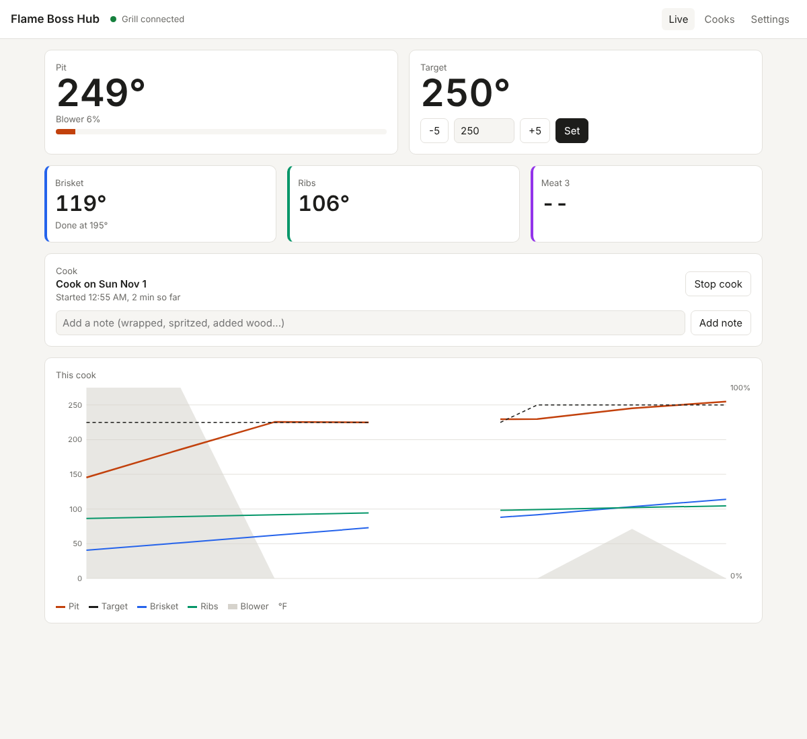

# Flame Boss Hub

A local replacement for the Flame Boss / EGG Genius grill app. It runs on a
computer on your home network (Docker, Unraid, a Raspberry Pi, or a plain
Windows/Mac/Linux program), talks straight to the grill controller, and keeps
working when the Flame Boss cloud is down on a holiday.



## What it does

- **Live page:** pit temperature, three meat probes (with the names you gave
  them in the app), blower, and the target temperature you can change.
- **Alarms:** a banner and a Silence button when the controller beeps, plus
  optional phone alerts through [ntfy](https://ntfy.sh).
- **Cook history:** every cook is recorded with a graph, the target changes,
  alarms, and your notes. Download any cook as a spreadsheet (CSV).
  A cook starts by itself when the pit passes 122°F / 50°C, and ends after the
  pit has been cold or unplugged for 30 minutes. You can also start and stop it
  yourself.
- **Home Assistant (optional), two ways:**
  1. Point the [Flame Boss Home Assistant integration](https://github.com/jsttylr/flameboss-ha)
     at this hub instead of at the grill. The hub acts like a grill, so the
     integration works unchanged.
  2. Or turn on "Publish to an MQTT broker" and the grill shows up in Home
     Assistant's built-in MQTT integration with no custom integration at all.

Why go through the hub? The controller only accepts two or three local
connections, and its cloud link uses one. With the hub, the grill only ever
sees one local connection, and every cook is recorded even when Home Assistant
is restarting.

## Install

### Unraid

Add the template from
`https://raw.githubusercontent.com/jsttylr/flameboss-hub/main/unraid/flameboss-hub.xml`.
Settings and cook history are kept in `/mnt/user/appdata/flameboss-hub`.
The image is tagged `main` for the newest build; `latest` appears once a
release is published.

### Docker

```
docker run -d --name flameboss-hub --restart unless-stopped -p 8075:8075 -p 1884:1883 -e TZ=America/New_York -v flameboss-data:/data ghcr.io/jsttylr/flameboss-hub:latest
```

Or use the included `docker-compose.yml`.

### Windows, Mac, Linux, Raspberry Pi

Download the program for your computer from the latest release and run it.
The page is at `http://<that computer>:8075/`.

## Set up

Open the page, go to **Settings**, and enter the controller's IP address and
PIN. Find the PIN in the Flame Boss or EGG Genius app under Controllers,
Security, Show PIN. Give the controller a fixed IP address in your router.

If you use the Home Assistant integration, disable or remove its direct grill
connection first, then add it again with the hub's IP address, port 1884 (or
whatever you mapped), and the same PIN.

## Settings without the page

These environment variables fill in the first-run settings:
`FLAMEBOSS_HOST`, `FLAMEBOSS_PIN`, `FLAMEBOSS_PORT` (1883), `FLAMEBOSS_UNITS`
(F or C), `FLAMEBOSS_MIRROR` (0 to turn off the built-in broker),
`FLAMEBOSS_MIRROR_PORT` (1883 inside the container), `FLAMEBOSS_NTFY_URL`,
`FLAMEBOSS_DATA` (/data), `FLAMEBOSS_LISTEN` (0.0.0.0:8075), `TZ`.

## How it talks to the grill

MQTT 3.1.1 to the controller's built-in broker on port 1883, username `fb`,
password = PIN, as described in Flame Boss's
[API documentation](https://github.com/flameboss/fb-api-doc). Subscribing at
QoS 1 and pinging every 5 seconds matters: the controller stops talking to
clients that don't acknowledge its messages or go quiet for 10 seconds.

Not affiliated with Flame Boss or Big Green Egg.
